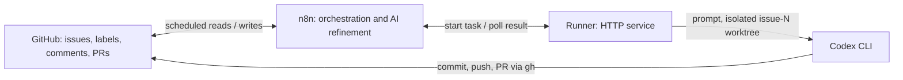

# Architecture

n8n remains the state authority. The runner has a narrow responsibility: create a disposable worktree, run one coding-agent invocation for at most 30 minutes, and return a structured result. GitHub is the auditable system of record.
